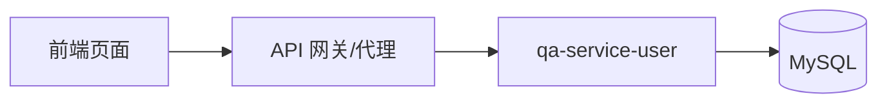

# PRD 文档模版

> **用途说明**：本模版用于在本项目中编写规范的产品需求文档（Product Requirements Document，PRD）。  
> AI 或开发者在实现新特性前，应复制本模版并填写全部必填章节，再据此完成设计与开发。

---

## 如何使用本模版

### 给 AI 的编写指引

1. **复制模版**：将下方「PRD 正文模版」整段复制为新文件，命名建议：`docs/prd/PRD-<特性编号>-<特性名称>.md`
2. **阅读上下文**：实现前须阅读 `README.md`、相关页面源码及 `docs/API_TEST.md`
3. **逐项填写**：不得留空必填项；不适用的选填项标注「不适用」
4. **保持可测试**：每条需求须对应可验证的验收标准与测试方式
5. **拆分任务**：若实现步骤超过 8 项，须在「实现拆分」章节拆为可独立交付的子任务
6. **对齐项目结构**：
   - 前端：`web/qa-web/`
   - 后端：`server/qa-service-user/`、`server/qa-service-question/`
   - 文档与测试：`docs/`

### 给 AI 的开发指引

完成 PRD 编写后，按以下顺序执行开发：

1. 阅读 PRD 全文，确认范围与验收标准
2. 按「实现拆分」章节顺序逐项实现（先基础设施，后业务逻辑，最后联调）
3. 每完成一项子任务，对照验收标准自检
4. 按 PRD「测试要求」补充或更新 `docs/API_TEST.md` 中的 curl 用例
5. 生成测试报告 `docs/API_TEST_REPORT.md`（可参考 `API_TEST.md` 中的报告模版）

---

## 文档状态说明

| 状态 | 含义 |
|------|------|
| 草稿 | 需求梳理中，尚未评审 |
| 评审中 | 待确认范围与验收标准 |
| 已批准 | 可进入开发 |
| 开发中 | 正在实现 |
| 已完成 | 已实现并通过验收 |
| 已取消 | 不再实施 |

---

## 优先级说明

| 级别 | 含义 |
|------|------|
| P0 | 必须实现，阻塞上线 |
| P1 | 核心功能，当前迭代必须完成 |
| P2 | 重要但可延后 |
| P3 | 优化项，资源允许时实现 |

---

# PRD 正文模版

> 从下一行开始为 PRD 正文，创建新文档时复制使用。

---

# PRD：[特性名称]

## 文档信息

| 字段 | 内容 |
|------|------|
| **文档编号** | PRD-XXX |
| **特性名称** | [填写特性名称] |
| **版本** | v1.0 |
| **作者** | [填写作者] |
| **创建日期** | YYYY-MM-DD |
| **最后更新** | YYYY-MM-DD |
| **状态** | 草稿 / 评审中 / 已批准 / 开发中 / 已完成 / 已取消 |
| **关联需求** | [对应 README 需求条目，如「需求 3：问诊用户登录」] |

---

## 1. 背景与目标

### 1.1 背景

[描述当前业务现状、用户痛点或技术现状。说明为什么需要做这个特性。]

**示例：**
> 当前问诊页使用姓名+生日验证身份，无法区分用户账号，也不利于数据持久化与安全管理。需要改为标准的用户名密码登录方式。

### 1.2 目标

[用 1～3 句话描述本特性要达成的业务目标。]

- 目标 1：[可衡量的目标]
- 目标 2：[可衡量的目标]

### 1.3 非目标（Out of Scope）

[明确本特性**不包含**的内容，避免范围蔓延。]

- [非目标 1]
- [非目标 2]

---

## 2. 用户与场景

### 2.1 目标用户

| 角色 | 描述 | 核心诉求 |
|------|------|---------|
| [如：问诊患者] | [角色说明] | [诉求] |
| [如：医生] | [角色说明] | [诉求] |

### 2.2 用户故事

#### 故事 1

- **作为** [用户角色]
- **我希望** [完成某操作]
- **以便** [获得某价值]

**验收标准：**
- [ ] [可验证标准 1]
- [ ] [可验证标准 2]

#### 故事 2

- **作为** [用户角色]
- **我希望** [完成某操作]
- **以便** [获得某价值]

**验收标准：**
- [ ] [可验证标准 1]

---

## 3. 功能需求

> 每条需求须有唯一编号，便于追踪与测试。

### 3.1 功能需求列表

| 编号 | 需求描述 | 优先级 | 关联故事 |
|------|---------|--------|---------|
| FR-001 | [具体功能描述] | P0/P1/P2 | 故事 1 |
| FR-002 | [具体功能描述] | P1 | 故事 2 |

### 3.2 功能详述

#### FR-001：[需求标题]

**描述：**  
[详细说明功能行为、输入、输出、边界条件]

**业务规则：**
- 规则 1
- 规则 2

**交互说明（如有 UI）：**
- 页面路径：`/xxx`
- 触发方式：[按钮/表单/自动]
- 成功反馈：[提示文案或跳转]
- 失败反馈：[错误提示]

---

## 4. 非功能需求

### 4.1 性能

| 编号 | 要求 |
|------|------|
| NFR-001 | [如：接口 P95 响应时间 < 500ms] |

### 4.2 安全

| 编号 | 要求 |
|------|------|
| NFR-010 | [如：密码不得通过列表接口返回] |
| NFR-011 | [如：登录失败返回 401，不泄露用户是否存在] |

### 4.3 兼容性

| 编号 | 要求 |
|------|------|
| NFR-020 | [如：支持 Chrome/Edge 最新两个大版本] |

### 4.4 可维护性

| 编号 | 要求 |
|------|------|
| NFR-030 | [如：接口变更须同步更新 API_TEST.md] |

---

## 5. 技术方案

### 5.1 总体架构

[描述特性在前后端中的位置，可用文字或 mermaid 图]



### 5.2 前端方案

| 项目 | 说明 |
|------|------|
| 涉及目录 | `web/qa-web/src/...` |
| 涉及页面/组件 | [如：Consultation.vue] |
| 状态管理 | [如：store/index.ts] |
| API 封装 | [如：src/api/xxx.ts] |
| 路由变更 | [有/无，说明] |

### 5.3 后端方案

| 项目 | 说明 |
|------|------|
| 涉及服务 | [qa-service-user / qa-service-question] |
| 新增/修改接口 | 见 5.5 |
| 数据表 | [表名及主要字段] |
| 依赖组件 | [JPA / Spring Security 等] |

### 5.4 数据模型

#### 表名：`[table_name]`

| 字段 | 类型 | 必填 | 说明 |
|------|------|------|------|
| id | VARCHAR | 是 | 主键 |
| ... | ... | ... | ... |

**初始数据：** [有/无，来源说明]

### 5.5 接口设计

#### API-001：[接口名称]

| 项目 | 内容 |
|------|------|
| 方法 | GET / POST / PUT / DELETE |
| 路径 | `/api/xxx` |
| 说明 | [接口用途] |

**请求参数 / Body：**

```json
{
  "field": "value"
}
```

**成功响应（200）：**

```json
{
  "field": "value"
}
```

**错误响应：**

| 状态码 | 场景 |
|--------|------|
| 400 | [参数错误] |
| 401 | [未授权] |
| 404 | [资源不存在] |

### 5.6 数据库与部署

| 项目 | 说明 |
|------|------|
| Docker | [是否涉及 server/docker-compose.yml] |
| 迁移脚本 | [init.sql / data.sql 路径] |
| 配置项 | [application.properties 变更] |

---

## 6. 界面与交互（如适用）

### 6.1 页面线框/流程

[文字描述或引用设计图路径]

1. 用户进入 [页面]
2. 用户执行 [操作]
3. 系统展示 [结果]

### 6.2 文案与状态

| 场景 | 文案/状态 |
|------|----------|
| 登录成功 | [提示文案] |
| 登录失败 | [提示文案] |
| 加载中 | [loading 状态] |

---

## 7. 验收标准

> 特性整体完成的判定依据，须全部满足方可标记 PRD 为「已完成」。

| 编号 | 验收项 | 验证方式 |
|------|--------|---------|
| AC-001 | [验收描述] | [手动 / curl / 自动化测试] |
| AC-002 | [验收描述] | [验证方式] |

---

## 8. 测试要求

### 8.1 接口测试（curl）

[列出须补充到 `docs/API_TEST.md` 的测试用例编号与简述]

| 用例编号 | 接口 | 场景 |
|---------|------|------|
| TC-XX | POST /api/xxx | 成功场景 |
| TC-XX | POST /api/xxx | 失败场景 |

### 8.2 前端测试

- [ ] 页面正常渲染
- [ ] 正向流程可走通
- [ ] 错误提示符合 PRD
- [ ] 与后端联调通过

### 8.3 测试报告

完成后须生成 `docs/API_TEST_REPORT.md`，包含通过率与失败分析。

---

## 9. 实现拆分

> **AI 开发必读**：按序号依次实现，每项完成后对照验收标准自检。  
> 若步骤超过 8 项，须拆分为 Phase 1 / Phase 2 或独立子特性。

| 步骤 | 任务 | 产出物 | 依赖 | 预估 |
|------|------|--------|------|------|
| 1 | [如：设计数据表与实体] | Entity、init.sql | 无 | - |
| 2 | [如：实现 Repository/Service] | Service 类 | 步骤 1 | - |
| 3 | [如：实现 Controller 接口] | REST API | 步骤 2 | - |
| 4 | [如：前端 API 封装] | api/xxx.ts | 步骤 3 | - |
| 5 | [如：改造页面与 store] | Vue 组件 | 步骤 4 | - |
| 6 | [如：前后端联调] | 可运行功能 | 步骤 5 | - |
| 7 | [如：更新 API_TEST.md] | 测试文档 | 步骤 6 | - |
| 8 | [如：执行 curl 测试并写报告] | API_TEST_REPORT.md | 步骤 7 | - |

### 9.1 拆分原则

- 每步可独立验证，避免「大块头」一次性提交
- 先后端契约（API），后前端集成
- 数据层 → 服务层 → 接口层 → 前端层 → 联调 → 文档

---

## 10. 风险与依赖

### 10.1 风险

| 风险 | 影响 | 概率 | 缓解措施 |
|------|------|------|---------|
| [如：MySQL 未启动] | 高 | 中 | 提供 docker-compose 与启动说明 |

### 10.2 依赖

| 依赖项 | 类型 | 说明 |
|--------|------|------|
| [如：qa-service-user 已运行] | 服务 | 端口 8080 |
| [如：doctors 表已存在] | 数据 | 医生模块已完成 |

---

## 11. 里程碑与排期（可选）

| 阶段 | 内容 | 计划完成日期 |
|------|------|-------------|
| 设计评审 | PRD 评审通过 | YYYY-MM-DD |
| 开发完成 | 代码与联调完成 | YYYY-MM-DD |
| 测试完成 | 测试报告输出 | YYYY-MM-DD |

---

## 12. 附录

### 12.1 术语表

| 术语 | 定义 |
|------|------|
| 问诊用户 | 使用平台进行在线问诊的患者 |
| PRD | Product Requirements Document，产品需求文档 |

### 12.2 参考文档

- [README.md](../README.md)
- [API_TEST.md](./API_TEST.md)
- [相关页面源码路径]

### 12.3 修订记录

| 版本 | 日期 | 作者 | 变更说明 |
|------|------|------|---------|
| v1.0 | YYYY-MM-DD | [作者] | 初稿 |

---

## 附录：AI 快速提示词参考

将本模版填写完成后，可使用如下提示词驱动 AI 开发：

```
请阅读 docs/prd/PRD-XXX-<特性名称>.md，严格按照 PRD 中「实现拆分」章节的步骤顺序完成开发。
要求：
1. 每完成一步，对照该步骤产出物与 PRD 验收标准自检
2. 后端变更在 server/qa-service-user 中实现
3. 前端变更在 web/qa-web 中实现
4. 完成后更新 docs/API_TEST.md 并执行 curl 测试
5. 生成 docs/API_TEST_REPORT.md 测试报告
```
