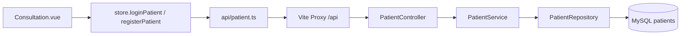

# PRD：问诊用户用户名密码登录

## 文档信息

| 字段 | 内容 |
|------|------|
| **文档编号** | PRD-003 |
| **特性名称** | 问诊用户用户名密码登录 |
| **版本** | v1.0 |
| **作者** | QA Healthcare Team |
| **创建日期** | 2026-07-01 |
| **最后更新** | 2026-07-01 |
| **状态** | 已完成 |
| **关联需求** | README 需求 3：为问诊用户提供用户名密码登录方式 |

---

## 1. 背景与目标

### 1.1 背景

当前问诊页（`Consultation.vue`）原先采用「姓名 + 生日」进行身份验证：用户输入任意姓名和生日即可进入系统，首次输入会自动在前端 JSON 中创建账户。该方式存在以下问题：

- **无标准账号体系**：无法通过唯一用户名标识用户，同名用户难以区分
- **数据仅存前端**：患者信息保存在 `patient-user.json`，无法与后端服务、数据库统一管理
- **安全性不足**：无密码校验，任何人知晓姓名和生日即可冒充
- **与医生登录不一致**：医生已采用用户名密码登录，患者侧体验与架构不统一

为支撑后续问诊数据持久化、权限控制及与 `qa-service-user` 用户体系统一，需要将患者认证升级为**用户名 + 密码**方式，并提供注册能力。

### 1.2 目标

- 为问诊患者提供基于用户名、密码的**登录**与**注册**能力
- 患者数据存储至 MySQL `patients` 表，由 `qa-service-user` 提供 REST API
- 改造问诊页认证区域，替换原有姓名+生日验证流程
- 提供可 curl 验证的接口及完整测试文档

### 1.3 非目标（Out of Scope）

- 不实现 JWT / Session / OAuth 等令牌机制（本期仅完成登录校验并返回用户信息）
- 不对密码进行 BCrypt 等加密存储（面试演示环境，明文比对；生产环境须另行加固）
- 不改造医生登录、医生数据、首页 i18n 等其他需求
- 不将问诊问题（questions）数据迁移至后端（仍使用前端 JSON）
- 不实现找回密码、手机验证码、图形验证码等功能

---

## 2. 用户与场景

### 2.1 目标用户

| 角色 | 描述 | 核心诉求 |
|------|------|---------|
| 问诊患者 | 使用平台进行在线问诊的终端用户 | 使用账号密码快速登录，新用户可注册 |
| 开发/测试人员 | 联调与验收 | 有固定测试账号，接口可用 curl 验证 |

### 2.2 用户故事

#### 故事 1：老用户登录

- **作为** 已注册的问诊患者
- **我希望** 在问诊页使用用户名和密码登录
- **以便** 进入我的问诊门户并查看/提交问题

**验收标准：**
- [x] 问诊页展示「登录」Tab，含用户名、密码输入框
- [x] 正确账号登录后进入患者门户，显示用户姓名
- [x] 错误密码提示「用户名或密码错误」

#### 故事 2：新用户注册

- **作为** 尚未注册的新患者
- **我希望** 在问诊页注册账号并填写基本信息
- **以便** 获得唯一用户名并立即使用问诊服务

**验收标准：**
- [x] 问诊页展示「注册」Tab，必填用户名、密码、姓名
- [x] 注册成功后自动登录并进入患者门户
- [x] 重复用户名注册失败并提示

#### 故事 3：切换用户

- **作为** 已登录患者
- **我希望** 退出当前账号
- **以便** 切换其他用户登录

**验收标准：**
- [x] 点击「切换用户」后回到登录/注册界面
- [x] 当前患者会话状态被清除

---

## 3. 功能需求

### 3.1 功能需求列表

| 编号 | 需求描述 | 优先级 | 关联故事 |
|------|---------|--------|---------|
| FR-001 | 后端提供患者登录接口 `POST /api/patients/login` | P0 | 故事 1 |
| FR-002 | 后端提供患者注册接口 `POST /api/patients/register` | P0 | 故事 2 |
| FR-003 | 患者数据持久化至 MySQL `patients` 表 | P0 | 故事 1、2 |
| FR-004 | 问诊页改造为登录/注册 Tab 表单 | P0 | 故事 1、2 |
| FR-005 | 登录/注册成功后写入前端 store 当前患者状态 | P0 | 故事 1、2 |
| FR-006 | 支持切换用户（登出） | P1 | 故事 3 |
| FR-007 | 提供测试账号与 curl 测试用例 | P1 | 全部 |

### 3.2 功能详述

#### FR-001：患者登录

**描述：**  
客户端提交 `username`、`password`，服务端校验后返回患者信息（不含密码）。

**业务规则：**
- 用户名、密码均不能为空
- 用户名不存在或密码不匹配时返回 HTTP 401
- 响应体不包含 `password` 字段

**交互说明：**
- 页面路径：`/consultation`
- 触发方式：登录 Tab → 填写表单 → 点击「登录」
- 成功反馈：`message.success('登录成功，欢迎回来！')`，进入患者门户
- 失败反馈：`message.error('用户名或密码错误')`

#### FR-002：患者注册

**描述：**  
新用户提交用户名、密码、姓名及可选字段（生日、性别、手机），服务端创建账户并返回用户信息。

**业务规则：**
- 用户名、密码、姓名为必填
- 用户名全局唯一，重复时返回 HTTP 400
- 注册成功后返回完整患者信息（不含密码）

**交互说明：**
- 页面路径：`/consultation` → 注册 Tab
- 成功反馈：`message.success('注册成功，欢迎使用问诊服务！')`
- 失败反馈：`message.error('注册失败，用户名可能已存在')`

#### FR-004：问诊页 UI 改造

**描述：**  
移除原「姓名 + 生日」验证表单，替换为 Ant Design Vue 的 Tabs（登录 / 注册），风格与医生登录页保持一致。

---

## 4. 非功能需求

### 4.1 性能

| 编号 | 要求 |
|------|------|
| NFR-001 | 登录/注册接口 P95 响应时间 < 1s（本地开发环境） |

### 4.2 安全

| 编号 | 要求 |
|------|------|
| NFR-010 | 列表及登录响应不得返回 `password` 字段 |
| NFR-011 | 登录失败统一返回 401，不区分「用户不存在」与「密码错误」 |
| NFR-012 | 注册重复用户名返回 400，错误信息不泄露其他用户数据 |

### 4.3 兼容性

| 编号 | 要求 |
|------|------|
| NFR-020 | 前端通过 Vite 代理 `/api` → `localhost:8080` 访问后端 |
| NFR-021 | 后端 CORS 已配置，支持浏览器跨域请求 |

### 4.4 可维护性

| 编号 | 要求 |
|------|------|
| NFR-030 | 接口变更须同步更新 `docs/API_TEST.md` 及测试脚本 |
| NFR-031 | 种子数据通过 `data.sql` / `init.sql` 维护 |

---

## 5. 技术方案

### 5.1 总体架构



### 5.2 前端方案

| 项目 | 说明 |
|------|------|
| 涉及目录 | `web/qa-web/src/views/`、`src/store/`、`src/api/` |
| 涉及页面/组件 | `Consultation.vue` |
| 状态管理 | `store/index.ts`：`loginPatient`、`registerPatient`、`logoutPatient` |
| API 封装 | `src/api/patient.ts` |
| 路由变更 | 无（仍为 `/consultation`、`/consultation/:doctorUsername`） |

### 5.3 后端方案

| 项目 | 说明 |
|------|------|
| 涉及服务 | `qa-service-user` |
| 新增接口 | `POST /api/patients/login`、`POST /api/patients/register` |
| 数据表 | `patients` |
| 依赖组件 | Spring Data JPA、MySQL |

### 5.4 数据模型

#### 表名：`patients`

| 字段 | 类型 | 必填 | 说明 |
|------|------|------|------|
| id | VARCHAR(20) | 是 | 主键，如 `patient001` |
| username | VARCHAR(100) | 是 | 登录用户名，唯一 |
| password | VARCHAR(255) | 是 | 登录密码 |
| name | VARCHAR(100) | 是 | 真实姓名 |
| birthday | VARCHAR(20) | 是 | 生日，格式 YYYY-MM-DD，可为空字符串 |
| phone | VARCHAR(50) | 是 | 手机号，可为空字符串 |
| gender | VARCHAR(10) | 是 | 性别，可为空字符串 |

**初始数据：** 5 条种子用户（来源原 `patient-user.json`，补充 username/password）

| username | password | name |
|----------|----------|------|
| zhaoming | 123456 | 赵明 |
| sunli | 123456 | 孙丽 |
| zhoujie | 123456 | 周杰 |
| wufang | 123456 | 吴芳 |
| zhenghao | 123456 | 郑浩 |

### 5.5 接口设计

#### API-001：患者登录

| 项目 | 内容 |
|------|------|
| 方法 | POST |
| 路径 | `/api/patients/login` |
| 说明 | 问诊用户登录 |

**请求 Body：**

```json
{
  "username": "zhaoming",
  "password": "123456"
}
```

**成功响应（200）：**

```json
{
  "id": "patient001",
  "username": "zhaoming",
  "name": "赵明",
  "birthday": "1985-03-15",
  "phone": "138****1234",
  "gender": "男"
}
```

**错误响应：**

| 状态码 | 场景 |
|--------|------|
| 401 | 用户名或密码错误 |

#### API-002：患者注册

| 项目 | 内容 |
|------|------|
| 方法 | POST |
| 路径 | `/api/patients/register` |
| 说明 | 新患者注册 |

**请求 Body：**

```json
{
  "username": "newuser",
  "password": "123456",
  "name": "新用户",
  "birthday": "1990-01-01",
  "phone": "",
  "gender": "男"
}
```

**成功响应（200）：** 同登录响应结构

**错误响应：**

| 状态码 | 场景 |
|--------|------|
| 400 | 用户名已存在、必填项为空 |

### 5.6 数据库与部署

| 项目 | 说明 |
|------|------|
| Docker | 沿用 `server/docker-compose.yml` 中 MySQL |
| 迁移脚本 | `server/qa-service-user/src/main/resources/db/init.sql` |
| 种子数据 | `server/qa-service-user/src/main/resources/data.sql` |
| JPA | `ddl-auto=update`，自动建表 |

---

## 6. 界面与交互

### 6.1 页面流程

1. 用户访问 `/consultation`，未登录时展示认证卡片
2. 默认显示「登录」Tab，可切换至「注册」Tab
3. 登录/注册成功 → 展示患者门户（我的问题、提交问题）
4. 点击「切换用户」→ 清除会话，回到步骤 1

### 6.2 文案与状态

| 场景 | 文案/状态 |
|------|----------|
| 登录成功 | 登录成功，欢迎回来！ |
| 登录失败 | 用户名或密码错误 |
| 注册成功 | 注册成功，欢迎使用问诊服务！ |
| 注册失败 | 注册失败，用户名可能已存在 |
| 加载中 | 按钮 `:loading="authLoading"` |
| 测试提示 | 用户名: zhaoming, 密码: 123456 |

---

## 7. 验收标准

| 编号 | 验收项 | 验证方式 | 结果 |
|------|--------|---------|------|
| AC-001 | `POST /api/patients/login` 正确账号返回 200 | curl TC-11 | 已通过 |
| AC-002 | `POST /api/patients/login` 错误密码返回 401 | curl TC-12 | 已通过 |
| AC-003 | `POST /api/patients/register` 新用户返回 200 | curl TC-13 | 已通过 |
| AC-004 | `POST /api/patients/register` 重复用户名返回 400 | curl TC-14 | 已通过 |
| AC-005 | 问诊页登录 Tab 可成功登录并进入门户 | 手动 / 视频演示 | 已通过 |
| AC-006 | 问诊页注册 Tab 可注册新用户 | 手动 / 视频演示 | 已通过 |
| AC-007 | 响应体不包含 password 字段 | curl 检查 JSON | 已通过 |
| AC-008 | `patients` 表存在且含 5 条种子数据 | phpMyAdmin / SQL | 已通过 |
| AC-009 | 全部 14 条 API 测试通过 | `run-api-tests.ps1` | 已通过 |

---

## 8. 测试要求

### 8.1 接口测试（curl）

| 用例编号 | 接口 | 场景 |
|---------|------|------|
| TC-11 | POST /api/patients/login | 患者登录成功 |
| TC-12 | POST /api/patients/login | 患者登录失败 |
| TC-13 | POST /api/patients/register | 患者注册成功 |
| TC-14 | POST /api/patients/register | 患者注册重复 |

详见 [API_TEST.md](../API_TEST.md) 第 5 节。

### 8.2 前端测试

- [x] 登录 Tab 表单校验（用户名、密码必填）
- [x] 注册 Tab 表单校验（用户名、密码、姓名必填）
- [x] 登录成功后展示患者姓名与问题列表
- [x] 切换用户后回到登录页

### 8.3 测试报告

已生成 [API_TEST_REPORT.md](../API_TEST_REPORT.md)，14/14 用例通过。

---

## 9. 实现拆分

| 步骤 | 任务 | 产出物 | 依赖 | 状态 |
|------|------|--------|------|------|
| 1 | 设计 `patients` 表与 JPA 实体 | `Patient.java`、`init.sql` | MySQL 已就绪 | 已完成 |
| 2 | 实现 Repository 与 Service | `PatientRepository`、`PatientService` | 步骤 1 | 已完成 |
| 3 | 实现 Controller 接口 | `PatientController` | 步骤 2 | 已完成 |
| 4 | 添加种子数据 | `data.sql` | 步骤 1 | 已完成 |
| 5 | 前端 API 封装 | `api/patient.ts` | 步骤 3 | 已完成 |
| 6 | 改造 store 患者认证逻辑 | `store/index.ts` | 步骤 5 | 已完成 |
| 7 | 改造 Consultation.vue UI | 登录/注册 Tabs | 步骤 6 | 已完成 |
| 8 | 前后端联调 | 端到端可用 | 步骤 7 | 已完成 |
| 9 | 更新 API_TEST.md 与测试脚本 | TC-11～TC-14 | 步骤 8 | 已完成 |
| 10 | 执行测试并生成报告 | `API_TEST_REPORT.md` | 步骤 9 | 已完成 |

### 9.1 拆分原则

- 先后端 API 契约，后前端集成
- 数据层 → 服务层 → 接口层 → 前端 API → 页面 → 联调 → 文档测试

---

## 10. 风险与依赖

### 10.1 风险

| 风险 | 影响 | 概率 | 缓解措施 |
|------|------|------|---------|
| MySQL 未启动导致接口不可用 | 高 | 中 | `createDatabaseIfNotExist=true` + docker-compose 文档 |
| 密码明文存储 | 高 | 确定 | PRD 标注为非目标；生产须加密 |
| PowerShell curl POST 传参失败 | 中 | 高 | 测试脚本使用临时文件 `--data-binary` |

### 10.2 依赖

| 依赖项 | 类型 | 说明 |
|--------|------|------|
| qa-service-user | 服务 | 端口 8080 |
| MySQL qa_healthcare | 数据 | `patients` 表 |
| 医生模块已完成 | 功能 | 问诊页选医生依赖 `store.fetchDoctors()` |

---

## 11. 里程碑与排期

| 阶段 | 内容 | 计划完成日期 | 实际完成 |
|------|------|-------------|---------|
| PRD 编写 | 本文档 | 2026-07-01 | 2026-07-01 |
| 开发完成 | 前后端联调 | 2026-07-01 | 2026-07-01 |
| 测试完成 | API 测试报告 | 2026-07-01 | 2026-07-01 |

---

## 12. 附录

### 12.1 术语表

| 术语 | 定义 |
|------|------|
| 问诊用户 | 在平台发起在线问诊的患者 |
| PRD | Product Requirements Document，产品需求文档 |
| PatientDTO | 后端返回的患者数据传输对象，不含密码 |

### 12.2 参考文档

- [README.md](../../README.md)
- [PRD_TEMPLATE.md](../PRD_TEMPLATE.md)
- [API_TEST.md](../API_TEST.md)
- [API_TEST_REPORT.md](../API_TEST_REPORT.md)
- [Consultation.vue](../../web/qa-web/src/views/Consultation.vue)
- [PatientController.java](../../server/qa-service-user/src/main/java/com/leansofx/qaserviceuser/controller/PatientController.java)

### 12.3 修订记录

| 版本 | 日期 | 作者 | 变更说明 |
|------|------|------|---------|
| v1.0 | 2026-07-01 | QA Healthcare Team | 初稿，特性已实现并通过测试 |

---

## 附录：AI 开发提示词

```
请阅读 docs/prd/PRD-003-问诊用户登录.md，严格按照 PRD 中「实现拆分」章节顺序完成开发。
要求：
1. 每完成一步，对照该步骤产出物与 PRD 验收标准自检
2. 后端变更在 server/qa-service-user 中实现
3. 前端变更在 web/qa-web 中实现（重点 Consultation.vue）
4. 完成后更新 docs/API_TEST.md 并执行 curl 测试
5. 生成 docs/API_TEST_REPORT.md 测试报告
```
