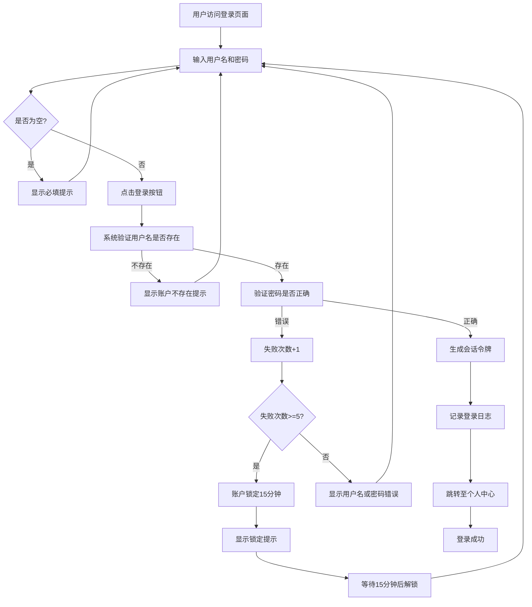

# 业务需求文档 (BRD) - 患者用户登录

## 文档信息

| 项目 | 内容 |
|------|------|
| 项目名称 | 在线医疗问诊平台 - 患者登录功能 |
| 版本号 | v1.0 |
| 编写人 | 产品团队 |
| 审核人 | 业务负责人 |
| 批准人 | 项目负责人 |
| 编写日期 | 2026-05-10 |
| 最后更新 | 2026-05-10 |

---

## 修订历史

| 版本 | 日期 | 作者 | 描述 | 审核人 |
|------|------|------|------|--------|
| v1.0 | 2026-05-10 | 产品团队 | 初始版本 | 业务负责人 |

---

## 1. 项目概述

### 1.1 背景说明
在线医疗问诊平台需要为患者用户提供安全、便捷的登录入口，使其能够访问个人健康档案、在线咨询医生、查看问诊记录等核心功能。当前系统缺少完善的患者身份认证机制，导致用户数据安全风险和用户身份识别问题。本需求旨在建立基于用户名和密码的患者登录体系，确保患者身份的真实性和数据访问的安全性。

### 1.2 业务目标
明确列出本项目要达成的业务目标：

- **目标1：** 实现95%以上的患者用户能够通过用户名密码成功登录系统
- **目标2：** 将未授权访问事件降低至0，确保患者健康数据的隐私安全
- **目标3：** 登录流程平均耗时不超过30秒，提升用户体验
- **目标4：** 支持日均10,000次登录请求，满足业务增长需求

### 1.3 业务范围
**包含的功能/业务：**
- 患者用户使用用户名和密码进行身份验证
- 登录状态管理和会话维持
- 登录失败处理和错误提示
- 密码安全存储和验证
- 登录后跳转至患者个人中心

**不包含的功能/业务：**
- 患者用户注册功能（属于独立需求模块）
- 第三方登录方式（微信、支付宝等）
- 手机号验证码登录
- 忘记密码和重置功能（属于独立需求模块）
- 医生端登录功能（属于独立需求模块）

### 1.4 目标用户群体
| 用户类型 | 描述 | 占比预估 | 核心需求 |
|----------|------|----------|----------|
| 首次登录患者 | 已完成注册但未登录过系统的患者用户 | 30% | 简单清晰的登录指引，快速完成首次登录 |
| 常规患者用户 | 经常使用系统进行问诊的患者 | 60% | 快速登录，减少操作步骤 |
| 老年患者用户 | 年龄较大、操作能力较弱的患者 | 10% | 大字体、清晰提示、简化流程 |

---

## 2. 业务现状分析

### 2.1 当前业务流程
目前系统缺乏完善的患者身份认证机制，存在以下情况：

```
用户访问系统 → 直接浏览部分公开内容 → 尝试访问个人功能 → 无明确登录入口 → 用户体验混乱
```

**当前问题：**
- 缺少统一的登录入口
- 用户身份无法有效识别
- 个人健康数据存在泄露风险
- 无法提供个性化的医疗服务

### 2.2 痛点与问题

1. **问题1：缺乏身份认证机制**
   - 影响：无法区分不同患者用户，数据安全性低
   - 频率：每次用户访问系统时都存在此问题

2. **问题2：用户体验不一致**
   - 影响：用户不知道如何访问个人功能，流失率高
   - 频率：约40%的用户在尝试使用个人功能时遇到困惑

3. **问题3：数据隐私风险**
   - 影响：患者健康档案可能被未授权访问
   - 频率：持续存在的合规风险

### 2.3 改进机会
基于痛点分析，识别出的业务改进机会：

- **机会1：** 建立标准化的患者登录流程，提升安全性和用户体验
- **机会2：** 通过身份认证实现个性化服务推荐，提高用户粘性
- **机会3：** 符合医疗健康数据保护法规要求，降低合规风险

---

## 3. 业务需求详述

### 3.1 功能性需求

#### 3.1.1 需求模块1：患者用户登录

**需求编号：** BRD-FR-001  
**优先级：** 高  
**需求描述：**  
患者用户能够通过输入用户名和密码的方式完成身份验证，成功登录后进入患者个人中心页面，可以访问个人健康档案、在线咨询、问诊记录等功能。

**业务场景：**  

- **场景1：正常登录**
  1. 患者用户访问系统首页
  2. 点击"患者登录"按钮
  3. 进入登录页面
  4. 输入正确的用户名和密码
  5. 点击"登录"按钮
  6. 系统验证通过，跳转至患者个人中心
  7. 显示欢迎信息和用户基本信息

- **场景2：登录失败 - 用户名或密码错误**
  1. 患者用户输入用户名
  2. 输入错误的密码
  3. 点击"登录"按钮
  4. 系统验证失败
  5. 显示明确的错误提示："用户名或密码错误"
  6. 保留用户名输入内容，清空密码输入框
  7. 用户可以重新输入密码再次尝试

- **场景3：登录失败 - 账户不存在**
  1. 患者用户输入未注册的用户名
  2. 输入任意密码
  3. 点击"登录"按钮
  4. 系统验证失败
  5. 显示提示："该账户不存在，请先注册"
  6. 提供"立即注册"链接

- **场景4：表单验证 - 必填项检查**
  1. 患者用户未输入用户名或密码
  2. 点击"登录"按钮
  3. 系统在客户端进行验证
  4. 显示提示："请输入用户名"或"请输入密码"
  5. 不发送服务器请求

**验收标准：**  
- [ ] 用户使用正确的用户名和密码能够成功登录
- [ ] 登录成功后能够正确跳转至患者个人中心页面
- [ ] 登录成功后系统能够正确识别并显示用户身份信息
- [ ] 用户名或密码错误时显示友好的错误提示信息
- [ ] 未填写必填项时进行前端验证提示
- [ ] 登录过程响应时间不超过3秒
- [ ] 连续登录失败5次后账户被临时锁定15分钟
- [ ] 密码在传输和存储过程中必须加密处理

**业务规则：**  
- 规则1：用户名必须是已注册的有效的患者账户
- 规则2：密码验证采用加密比对方式，不允许明文传输和存储
- 规则3：登录失败时不提示具体是用户名错误还是密码错误，统一提示"用户名或密码错误"，防止账户枚举攻击
- 规则4：连续登录失败5次后，账户自动锁定15分钟，期间无法登录
- 规则5：登录成功后生成会话令牌(Session Token)，有效期为24小时
- 规则6：同一账户不允许同时在多个设备登录，新登录会使旧会话失效
- 规则7：密码长度必须在8-20位之间，必须包含字母和数字

---

#### 3.1.2 需求模块2：登录页面展示

**需求编号：** BRD-FR-002  
**优先级：** 高  
**需求描述：**  
提供清晰、易用的登录页面界面，包含用户名输入框、密码输入框、登录按钮、错误提示区域和相关链接（注册、帮助等）。

**业务场景：**  
- 场景1：用户从首页进入登录页面
- 场景2：用户在登录页面看到清晰的表单和指引
- 场景3：用户可以根据需要跳转到注册页面或寻求帮助

**验收标准：**  
- [ ] 登录页面布局清晰，主要元素一目了然
- [ ] 用户名和密码输入框有明确的标签提示
- [ ] 密码输入框内容以密文形式显示（星号或圆点）
- [ ] 提供"记住我"选项（可选功能）
- [ ] 提供"注册新账户"链接
- [ ] 页面支持响应式设计，适配PC端和移动端
- [ ] 页面加载时间不超过2秒

**业务规则：**  
- 规则1：登录页面必须简洁明了，避免过多干扰元素
- 规则2：所有表单字段必须有清晰的标签和占位符提示
- 规则3：错误提示必须醒目但不突兀，使用红色文字或图标标识

---

#### 3.1.3 需求模块3：登录状态管理

**需求编号：** BRD-FR-003  
**优先级：** 中  
**需求描述：**  
系统需要管理用户的登录状态，包括会话维持、自动登出、会话过期处理等。

**业务场景：**  
- 场景1：用户登录后关闭浏览器，再次打开时仍需重新登录
- 场景2：用户长时间无操作，会话自动过期
- 场景3：用户在多个页面间切换，登录状态保持一致

**验收标准：**  
- [ ] 登录成功后，用户在有效期内访问任何页面都保持登录状态
- [ ] 会话过期后，用户访问受保护页面时自动跳转至登录页
- [ ] 用户主动退出登录后，会话立即失效
- [ ] 会话令牌安全存储，防止窃取

**业务规则：**  
- 规则1：会话有效期为24小时，从最后登录时间开始计算
- 规则2：用户超过30分钟无任何操作，会话自动失效
- 规则3：用户点击"退出登录"后，立即清除所有会话信息
- 规则4：会话令牌必须存储在安全的HttpOnly Cookie中

---

### 3.2 非功能性需求

#### 3.2.1 性能要求
- **响应时间：** 登录请求处理时间不超过3秒（从提交到返回结果）
- **并发能力：** 支持同时在线用户数5,000人，峰值登录请求1,000次/分钟
- **可用性：** 登录服务可用性达到99.9%，每月停机时间不超过43分钟

#### 3.2.2 安全性要求
- **数据隐私：** 
  - 密码必须使用bcrypt或同等强度算法加密存储
  - 登录请求必须通过HTTPS协议传输
  - 不得在日志中记录明文密码
  
- **权限控制：** 
  - 未登录用户只能访问公开页面
  - 登录后用户只能访问自己的数据和功能
  - 严禁越权访问其他用户的数据
  
- **合规要求：** 
  - 符合《个人信息保护法》要求
  - 符合《医疗健康数据安全管理办法》
  - 符合GDPR（如涉及国际用户）

#### 3.2.3 可用性要求
- **易用性：** 
  - 登录流程不超过3个步骤
  - 错误提示清晰易懂，不使用技术术语
  - 支持键盘快捷操作（Tab切换、Enter提交）
  
- **可访问性：** 
  - 支持屏幕阅读器
  - 颜色对比度符合WCAG 2.1 AA标准
  - 字体大小可调整

#### 3.2.4 兼容性要求
- **浏览器兼容：** Chrome、Firefox、Safari、Edge最新版本及前两个版本
- **设备兼容：** 支持PC端、平板、手机等各类设备
- **分辨率适配：** 支持1920x1080、1366x768、375x667等常见分辨率

---

## 4. 业务流程设计

### 4.1 核心业务流程

#### 流程1：患者用户登录流程

**流程描述：**  
患者用户通过输入用户名和密码完成身份验证，系统验证通过后授予访问权限，用户进入个人中心。

**流程图：**  


**流程步骤：**

| 步骤 | 操作 | 责任人/角色 | 输入 | 输出 | 备注 |
|------|------|-------------|------|------|------|
| 1 | 访问登录页面 | 患者用户 | URL链接 | 登录页面 | 可从首页或直接访问 |
| 2 | 输入用户名 | 患者用户 | 用户名文本 | 用户名填入输入框 | 用户名区分大小写 |
| 3 | 输入密码 | 患者用户 | 密码文本 | 密码以密文显示 | 密码隐藏显示 |
| 4 | 点击登录 | 患者用户 | 点击事件 | 触发验证流程 | 支持Enter键提交 |
| 5 | 前端验证 | 系统前端 | 表单数据 | 验证结果 | 检查必填项 |
| 6 | 发送请求 | 系统前端 | 用户名+密码 | HTTP请求 | HTTPS加密传输 |
| 7 | 验证用户名 | 系统后端 | 用户名 | 用户是否存在 | 查询数据库 |
| 8 | 验证密码 | 系统后端 | 密码哈希值 | 密码是否匹配 | 加密比对 |
| 9 | 检查锁定状态 | 系统后端 | 失败次数 | 是否被锁定 | 防止暴力破解 |
| 10 | 生成会话 | 系统后端 | 用户ID | Session Token | 有效期24小时 |
| 11 | 记录日志 | 系统后端 | 登录信息 | 日志记录 | 审计追踪 |
| 12 | 返回结果 | 系统后端 | 验证结果 | JSON响应 | 成功或失败 |
| 13 | 页面跳转 | 系统前端 | 响应结果 | 目标页面 | 成功跳个人中心 |
| 14 | 显示提示 | 系统前端 | 错误信息 | 用户可见提示 | 友好提示 |

**异常处理：**  
- 异常情况1：网络超时 → 处理方式：显示"网络连接失败，请重试"提示，允许用户重新提交
- 异常情况2：服务器错误 → 处理方式：显示"系统繁忙，请稍后重试"提示，记录错误日志
- 异常情况3：账户被锁定 → 处理方式：显示剩余锁定时间，提供倒计时提示
- 异常情况4：会话已存在 → 处理方式：使旧会话失效，记录异地登录提醒

---

### 4.2 辅助业务流程

#### 流程2：登录失败处理流程

**流程描述：**  
当用户登录失败时，系统根据不同失败原因提供相应的提示和处理方式。

**流程步骤：**

| 失败类型 | 提示信息 | 后续操作 | 安全措施 |
|----------|----------|----------|----------|
| 用户名不存在 | "该账户不存在，请先注册" | 提供注册链接 | 不透露账户是否存在 |
| 密码错误 | "用户名或密码错误" | 清空密码框，保留用户名 | 失败次数累加 |
| 账户被锁定 | "账户已锁定，请在XX分钟后重试" | 显示倒计时 | 阻止继续尝试 |
| 必填项为空 | "请输入用户名/密码" | 聚焦到空白字段 | 前端验证 |

---

## 5. 数据需求

### 5.1 关键业务数据
患者登录功能涉及的核心数据项：

| 数据项 | 类型 | 说明 | 来源 | 用途 |
|--------|------|------|------|------|
| 用户名 | 文本(50字符) | 用户唯一标识，区分大小写 | 用户注册时设置 | 身份识别 |
| 密码哈希值 | 文本(60字符) | 加密后的密码，不可逆 | 用户注册时加密存储 | 身份验证 |
| 用户ID | 数字 | 系统内部唯一标识 | 数据库自动生成 | 关联用户数据 |
| 登录时间 | 日期时间 | 用户最后登录时间 | 登录成功时记录 | 会话管理、审计 |
| 登录IP地址 | 文本(45字符) | 用户登录时的IP地址 | 自动获取 | 安全审计、异常检测 |
| 失败次数 | 数字 | 连续登录失败次数 | 登录失败时累加 | 账户锁定判断 |
| 锁定状态 | 布尔值 | 账户是否被锁定 | 失败次数达到阈值时设置 | 安全防护 |
| 锁定解除时间 | 日期时间 | 账户锁定的解除时间 | 锁定时计算 | 自动解锁 |
| 会话令牌 | 文本(128字符) | 用户会话的唯一标识 | 登录成功时生成 | 会话维持 |
| 会话过期时间 | 日期时间 | 会话的有效期截止时间 | 生成会话时计算 | 自动登出 |

### 5.2 数据报表需求

**报表1：登录统计日报**
- 频率：每日
- 维度：按日期、时间段（小时）
- 指标：
  - 总登录次数
  - 成功登录次数
  - 失败登录次数
  - 登录成功率
  - 活跃用户数（去重）
  - 平均登录耗时
- 受众：产品运营团队、技术运维团队

**报表2：安全审计周报**
- 频率：每周
- 维度：按用户、按IP地址
- 指标：
  - 异常登录次数（失败次数>3的用户）
  - 被锁定账户数量
  - 可疑IP地址列表
  - 异地登录记录
- 受众：安全团队、风控团队

**报表3：用户体验月报**
- 频率：每月
- 维度：按用户群体、按设备类型
- 指标：
  - 各渠道登录转化率
  - 登录页面跳出率
  - 平均登录时长
  - 用户满意度评分
- 受众：产品经理、用户体验团队

---

## 6. 利益相关方

### 6.1 项目干系人
| 角色 | 姓名/部门 | 职责 | 联系方式 |
|------|-----------|------|----------|
| 业务负责人 | 医疗业务部 | 确定业务需求，审批方案 | business@company.com |
| 产品经理 | 产品部 | 需求分析，产品设计 | product@company.com |
| 技术负责人 | 技术研发部 | 技术方案评审，开发实施 | tech@company.com |
| 安全专家 | 信息安全部 | 安全方案评审，渗透测试 | security@company.com |
| 最终用户代表 | 客服部 | 收集用户反馈，参与测试 | service@company.com |
| 法务顾问 | 法务部 | 合规性审查 | legal@company.com |

### 6.2 依赖关系
**内部依赖：**
- 用户注册模块：提供已注册的患者账户数据
- 数据库服务：存储用户信息和登录日志
- 前端框架：实现登录页面交互
- 后端服务：提供身份验证API

**外部依赖：**
- SSL证书服务商：提供HTTPS加密支持
- 云服务平台：提供服务器基础设施
- 监控告警系统：实时监控登录服务状态

---

## 7. 成功标准与KPI

### 7.1 业务成功标准
定义如何判断项目成功的具体标准：

- **标准1：** 上线后首月，患者用户登录成功率达到95%以上
- **标准2：** 因登录问题导致的用户投诉率低于1%
- **标准3：** 未发生任何因登录漏洞导致的数据泄露事件
- **标准4：** 用户登录平均耗时低于30秒（从进入登录页到成功跳转）

### 7.2 关键绩效指标 (KPI)
| KPI名称 | 当前值 | 目标值 | 测量方法 | 测量频率 |
|---------|--------|--------|----------|----------|
| 登录成功率 | 无数据 | ≥95% | 成功登录次数/总登录尝试次数 | 每日统计 |
| 平均登录耗时 | 无数据 | ≤30秒 | 从进入登录页到跳转完成的平均时间 | 每周统计 |
| 登录失败率 | 无数据 | ≤5% | 失败登录次数/总登录尝试次数 | 每日统计 |
| 账户锁定率 | 无数据 | ≤2% | 被锁定账户数/总活跃账户数 | 每周统计 |
| 用户满意度 | 无数据 | ≥4.5/5分 | 用户调研问卷评分 | 每月调研 |
| 安全事件数 | 无数据 | 0 | 安全审计发现的漏洞或攻击事件 | 实时监控 |

---

## 8. 风险与约束

### 8.1 业务风险
| 风险描述 | 可能性 | 影响程度 | 缓解措施 | 应急预案 |
|----------|--------|----------|----------|----------|
| 密码泄露导致账户被盗 | 中 | 高 | 强制密码复杂度要求，加密存储，HTTPS传输 | 立即重置受影响账户密码，通知用户 |
| 暴力破解攻击 | 中 | 高 | 账户锁定机制，IP限流，验证码（二期） | 封禁恶意IP，加强监控 |
| 会话令牌被窃取 | 低 | 高 | HttpOnly Cookie，短期有效期，HTTPS | 强制重新登录，撤销所有会话 |
| 用户忘记密码无法登录 | 高 | 中 | 提供清晰的找回密码指引（二期实现） | 客服人工协助验证身份后重置 |
| 系统故障导致无法登录 | 低 | 高 | 多节点部署，负载均衡，监控告警 | 切换到备用节点，紧急修复 |
| 合规风险（数据保护） | 中 | 高 | 法务审查，符合相关法律法规 | 立即整改，必要时暂停服务 |

### 8.2 约束条件
**时间约束：**  
- 必须在2026年6月30日前完成开发和测试
- 必须在2026年7月15日前正式上线

**预算约束：**  
- 项目开发成本控制在50万元以内
- 年度运维成本控制在10万元以内

**资源约束：**  
- 开发团队：2名后端工程师，1名前端工程师，1名测试工程师
- 服务器资源：现有云平台资源，无需额外采购

**合规约束：**  
- 必须符合《中华人民共和国个人信息保护法》
- 必须符合《医疗健康数据安全管理办法》
- 必须通过信息安全等级保护三级认证
- 用户数据必须存储在中国境内服务器

---

## 9. 实施计划（高层次）

### 9.1 阶段划分
| 阶段 | 时间周期 | 主要交付物 | 关键里程碑 |
|------|----------|------------|------------|
| 第一阶段：需求分析与设计 | 2026-05-10 ~ 2026-05-20 | 业务需求文档、UI设计稿、技术方案 | 需求评审通过 |
| 第二阶段：开发与单元测试 | 2026-05-21 ~ 2026-06-15 | 登录功能代码、单元测试用例 | 开发完成，代码审查通过 |
| 第三阶段：集成测试与安全测试 | 2026-06-16 ~ 2026-06-25 | 测试报告、安全审计报告 | 测试通过，无高危漏洞 |
| 第四阶段：UAT用户验收测试 | 2026-06-26 ~ 2026-06-30 | UAT测试报告、用户反馈 | 用户验收通过 |
| 第五阶段：上线部署 | 2026-07-01 ~ 2026-07-15 | 上线方案、运维手册 | 正式上线运行 |

### 9.2 关键时间节点
- **需求确认完成：** 2026-05-20
- **UI设计评审完成：** 2026-05-25
- **技术方案评审完成：** 2026-05-28
- **开发启动：** 2026-05-21
- **开发完成：** 2026-06-15
- **测试开始：** 2026-06-16
- **测试完成：** 2026-06-25
- **UAT开始：** 2026-06-26
- **UAT完成：** 2026-06-30
- **预发布环境部署：** 2026-07-01
- **正式上线：** 2026-07-15

---

## 10. 附录

### 10.1 术语表
| 术语 | 定义 |
|------|------|
| 用户名 | 用户在系统中唯一的身份标识，用于登录时识别用户身份 |
| 密码哈希值 | 密码经过加密算法处理后生成的固定长度字符串，不可逆向还原 |
| 会话令牌 | 用户登录成功后生成的临时凭证，用于维持登录状态 |
| HTTPS | 安全的HTTP协议，通过SSL/TLS加密传输数据 |
| bcrypt | 一种常用的密码加密算法，具有抗暴力破解特性 |
| 账户锁定 | 连续多次登录失败后，系统暂时禁止该账户登录的安全措施 |
| UAT | User Acceptance Testing，用户验收测试，由最终用户进行的测试 |
| 会话过期 | 用户长时间无操作或超过有效期后，登录状态自动失效 |

### 10.2 参考资料
- 《中华人民共和国个人信息保护法》
- 《医疗健康数据安全管理办法》
- 《信息安全技术 网络安全等级保护基本要求》
- OWASP Authentication Cheat Sheet
- WCAG 2.1 Web内容无障碍指南

### 10.3 附件
- 附件1：登录页面UI设计稿（待补充）
- 附件2：竞品登录功能分析报告（待补充）
- 附件3：用户调研报告（待补充）
- 附件4：安全技术方案详细说明（待补充）

---

## 审批签字

| 角色 | 姓名 | 签字 | 日期 |
|------|------|------|------|
| 业务负责人 | ________________ | | ____________ |
| 产品经理 | ________________ | | ____________ |
| 技术负责人 | ________________ | | ____________ |
| 安全专家 | ________________ | | ____________ |
| 项目负责人 | ________________ | | ____________ |

---

**文档结束**

## 使用说明

1. **本文档定位**：本文档专注于患者登录功能的业务需求，不包含技术实现细节
2. **后续工作**：基于本文档，技术团队将编写技术设计文档(TDD)，详细说明了实现方案
3. **变更管理**：任何需求变更都需要经过变更评审流程，并更新本文档
4. **追溯关系**：每个需求都有唯一编号，便于跟踪和测试用例设计
5. **验收依据**：本文档中的验收标准将作为功能验收的主要依据

## 注意事项

- ✅ **应该包含**：业务目标、用户需求、业务流程、验收标准、成功指标、安全要求
- ❌ **不应包含**：数据库表结构、API接口定义、代码实现、技术架构
- 📊 **数据驱动**：所有目标和指标都应可量化、可测量
- 🎯 **清晰明确**：需求描述应具体、无歧义，便于理解和执行
- 👥 **用户中心**：始终从患者用户的角度出发，关注用户体验
- 🔒 **安全第一**：作为医疗系统，安全和隐私保护是最高优先级