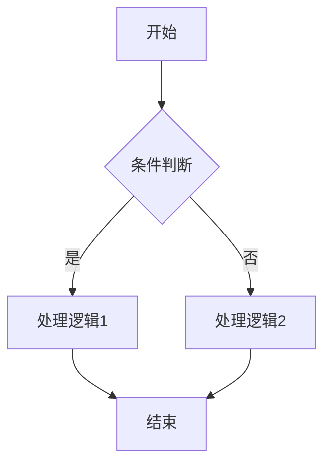
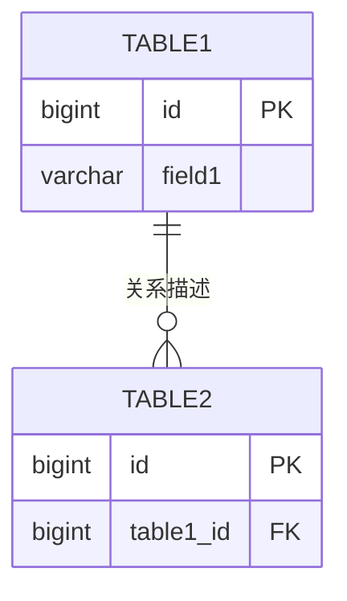
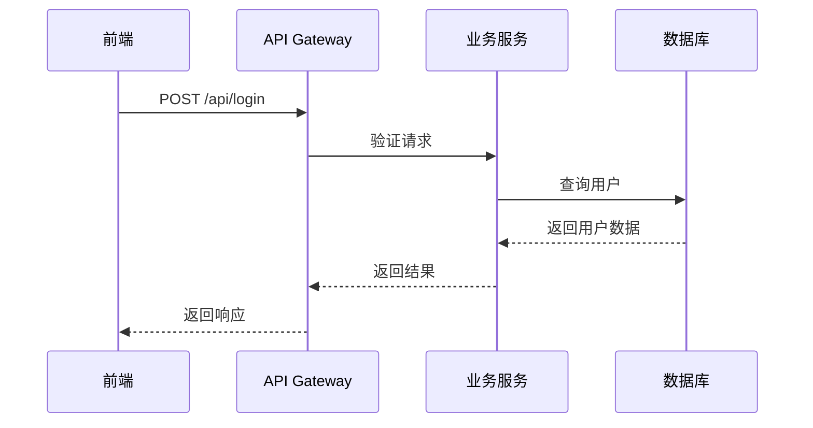

# 大模型开发需求文档 V1

> **文档说明**: 本文档专为AI大模型驱动的开发流程设计，旨在提供完整的业务和技术上下文，使大模型能够独立完成从需求分析到代码实现的全过程。

---

## 📋 文档元信息

| 字段 | 内容 |
|------|------|
| **功能名称** | [填写功能名称] |
| **功能编号** | [例如: FEAT-001] |
| **优先级** | [P0/P1/P2] |
| **创建日期** | [YYYY-MM-DD] |
| **最后更新** | [YYYY-MM-DD] |
| **状态** | [草稿/评审中/已批准/开发中/已完成] |
| **负责人** | [姓名] |
| **相关文档** | [链接到其他相关文档] |

---

## 🎯 第一部分：执行摘要（给大模型的快速指引）

### 1.1 核心任务描述
> **用一句话告诉大模型要做什么**

[简洁描述本功能的核心目标，例如：实现患者用户通过手机号验证码登录系统]

### 1.2 关键技术栈
- **后端框架**: [例如: Spring Boot 3.x]
- **前端框架**: [例如: Vue 3 + TypeScript]
- **数据库**: [例如: MySQL 8.0]
- **大模型服务**: [例如: OpenAI GPT-4 / 本地部署模型]
- **其他关键技术**: [列出关键依赖]

### 1.3 预期交付物
- [ ] 后端 API 接口（RESTful）
- [ ] 前端页面/组件
- [ ] 数据库表结构变更
- [ ] 单元测试
- [ ] API 文档
- [ ] 部署配置

---

## 📖 第二部分：完整业务上下文

### 2.1 业务背景与价值

#### 2.1.1 业务痛点
[描述当前存在的问题或用户需求，为什么需要这个功能]

**示例**:
```
目前患者无法通过移动端便捷登录系统，只能通过医生代为操作，导致：
1. 患者体验差，等待时间长
2. 医生工作负担重
3. 无法实现患者自主管理健康档案
```

#### 2.1.2 业务价值
[量化或定性描述功能带来的价值]

- **用户体验**: [提升点]
- **效率提升**: [具体指标]
- **商业价值**: [收入/成本影响]

### 2.2 用户画像与场景

#### 2.2.1 目标用户
| 用户类型 | 特征描述 | 使用频率 | 技术水平 |
|---------|---------|---------|---------|
| [用户类型1] | [描述] | [高频/中频/低频] | [高/中/低] |
| [用户类型2] | [描述] | [高频/中频/低频] | [高/中/低] |

#### 2.2.2 典型使用场景

**场景 1: [场景名称]**
- **触发条件**: [什么情况下用户使用此功能]
- **用户目标**: [用户想要达成什么]
- **操作流程**: 
  1. [步骤1]
  2. [步骤2]
  3. [步骤3]
- **成功标准**: [如何判断场景成功完成]
- **异常处理**: [可能的问题及处理方式]

**场景 2: [场景名称]**
[同上格式]

### 2.3 业务流程图



> **说明**: 使用 Mermaid 语法绘制流程图，确保大模型能理解业务流转

### 2.4 业务规则与约束

#### 2.4.1 核心业务规则
| 规则编号 | 规则描述 | 优先级 | 例外情况 |
|---------|---------|-------|---------|
| BR-001 | [规则描述] | P0 | [例外说明] |
| BR-002 | [规则描述] | P1 | [例外说明] |

#### 2.4.2 合规与安全要求
- **数据隐私**: [GDPR/个人信息保护法等要求]
- **权限控制**: [谁可以访问什么数据]
- **审计日志**: [需要记录哪些操作]
- **加密要求**: [数据传输/存储加密标准]

### 2.5 验收标准（业务视角）

| 验收项 | 验收标准 | 验证方法 |
|-------|---------|---------|
| AC-001 | [具体可衡量的标准] | [测试方法] |
| AC-002 | [具体可衡量的标准] | [测试方法] |

---

## 🔧 第三部分：技术上下文

### 3.1 现有系统架构

#### 3.1.1 系统整体架构
```
[用文字或 ASCII 图描述系统架构]

示例:
┌─────────────┐      ┌──────────────┐      ┌─────────────┐
│   Frontend   │─────▶│   Backend     │─────▶│   Database   │
│  (Vue 3)     │◀─────│ (Spring Boot) │◀─────│  (MySQL)     │
└─────────────┘      └──────────────┘      └─────────────┘
```

#### 3.1.2 相关模块依赖
[列出与本功能相关的现有模块及其职责]

| 模块名称 | 路径 | 职责 | 本次变更类型 |
|---------|------|------|------------|
| [模块1] | [相对路径] | [职责描述] | [新增/修改/无变更] |
| [模块2] | [相对路径] | [职责描述] | [新增/修改/无变更] |

#### 3.1.3 现有数据模型
[列出与本功能相关的现有实体/表]

**实体: [实体名称]**
- **文件位置**: [路径]
- **关键字段**: 
  - `field1`: [类型] - [说明]
  - `field2`: [类型] - [说明]
- **关联关系**: [与其他实体的关系]

### 3.2 技术选型与决策

#### 3.2.1 技术方案对比
| 方案 | 优点 | 缺点 | 选择理由 |
|-----|------|------|---------|
| [方案A] | [优点] | [缺点] | [是否选择及原因] |
| [方案B] | [优点] | [缺点] | [是否选择及原因] |

#### 3.2.2 最终技术决策
- **架构模式**: [例如: MVC / 微服务 / Serverless]
- **设计模式**: [例如: Repository Pattern / Strategy Pattern]
- **API 风格**: [RESTful / GraphQL / gRPC]
- **认证方式**: [JWT / Session / OAuth2]
- **缓存策略**: [Redis / 内存缓存 / 无缓存]

### 3.3 数据模型设计

#### 3.3.1 新增/修改的数据库表

**表名: `[table_name]`**

| 字段名 | 类型 | 约束 | 默认值 | 说明 |
|-------|------|------|-------|------|
| `id` | BIGINT | PRIMARY KEY, AUTO_INCREMENT | - | 主键 |
| `field1` | VARCHAR(255) | NOT NULL | - | 字段说明 |
| `field2` | INT | UNSIGNED | 0 | 字段说明 |
| `created_at` | TIMESTAMP | NOT NULL | CURRENT_TIMESTAMP | 创建时间 |
| `updated_at` | TIMESTAMP | NOT NULL | CURRENT_TIMESTAMP ON UPDATE | 更新时间 |

**索引设计**:
```sql
CREATE INDEX idx_field1 ON table_name(field1);
CREATE UNIQUE INDEX idx_unique_field ON table_name(field2);
```

**外键关系**:
```sql
ALTER TABLE table_name 
ADD CONSTRAINT fk_relation 
FOREIGN KEY (foreign_key_id) REFERENCES other_table(id);
```

#### 3.3.2 ER 图



### 3.4 API 接口设计

#### 3.4.1 接口列表

**接口 1: [接口名称]**

- **URL**: `POST /api/v1/[resource]`
- **描述**: [接口功能描述]
- **认证**: [需要/不需要] [认证类型]
- **请求头**:
  ```
  Content-Type: application/json
  Authorization: Bearer <token>
  ```

- **请求体**:
  ```json
  {
    "field1": "string",
    "field2": 123,
    "nestedObject": {
      "subField": "value"
    }
  }
  ```

- **请求参数说明**:
  | 参数名 | 类型 | 必填 | 说明 | 校验规则 |
  |-------|------|------|------|---------|
  | `field1` | String | 是 | 字段说明 | 长度 1-255 |
  | `field2` | Integer | 是 | 字段说明 | 范围 1-100 |

- **成功响应 (200/201)**:
  ```json
  {
    "code": 200,
    "message": "success",
    "data": {
      "id": 1,
      "field1": "value"
    }
  }
  ```

- **错误响应**:
  | HTTP 状态码 | 错误码 | 说明 |
  |------------|-------|------|
  | 400 | VALIDATION_ERROR | 参数校验失败 |
  | 401 | UNAUTHORIZED | 未认证 |
  | 404 | NOT_FOUND | 资源不存在 |
  | 500 | INTERNAL_ERROR | 服务器内部错误 |

- **业务逻辑**:
  1. [步骤1]
  2. [步骤2]
  3. [步骤3]

**接口 2: [接口名称]**
[同上格式]

#### 3.4.2 API 调用时序图



### 3.5 前端组件设计

#### 3.5.1 页面/组件结构

```
src/
├── views/
│   └── [PageName].vue          # 页面组件
├── components/
│   └── [ComponentName].vue     # 可复用组件
├── composables/
│   └── use[Feature].ts         # 组合式函数
├── stores/
│   └── [feature]Store.ts       # 状态管理
└── types/
    └── [feature].ts            # TypeScript 类型定义
```

#### 3.5.2 关键组件说明

**组件: [ComponentName]**
- **文件路径**: `src/components/[ComponentName].vue`
- **职责**: [组件功能描述]
- **Props**:
  ```typescript
  interface Props {
    prop1: string;
    prop2?: number;
  }
  ```
- **Events**:
  ```typescript
  const emit = defineEmits<{
    (e: 'event-name', payload: Type): void;
  }>();
  ```
- **状态管理**: [使用的 Store 或本地状态]
- **依赖服务**: [调用的 API]

#### 3.5.3 路由配置

```typescript
{
  path: '/route-path',
  name: 'RouteName',
  component: () => import('@/views/PageName.vue'),
  meta: {
    requiresAuth: true,
    title: '页面标题'
  }
}
```

### 3.6 安全设计

#### 3.6.1 认证与授权
- **认证方式**: [JWT / Session / OAuth2]
- **Token 有效期**: [例如: Access Token 15分钟, Refresh Token 7天]
- **权限控制**: 
  - [角色1]: 可访问 [资源列表]
  - [角色2]: 可访问 [资源列表]

#### 3.6.2 数据安全
- **敏感字段加密**: [哪些字段需要加密，使用什么算法]
- **SQL 注入防护**: [使用参数化查询/ORM]
- **XSS 防护**: [前端转义/CSP 策略]
- **CSRF 防护**: [Token 验证/SameSite Cookie]

#### 3.6.3 速率限制
- **登录接口**: [例如: 5次/分钟/IP]
- **普通接口**: [例如: 100次/分钟/IP]

---

## 🤖 第四部分：大模型开发指南

### 4.1 开发顺序与步骤

> **重要**: 请大模型严格按照以下顺序执行开发任务，每完成一步后验证再继续下一步。

#### 阶段 1: 数据库层开发
**任务目标**: 创建/修改数据库表和实体类

**执行步骤**:
1. 根据 3.3 节设计，生成数据库迁移脚本
2. 创建 JPA Entity 类
3. 创建 Repository 接口
4. 编写单元测试验证数据访问层

**验收标准**:
- [ ] 数据库表创建成功
- [ ] Entity 类与表结构一致
- [ ] Repository 基本 CRUD 测试通过

**参考文件**:
- 现有 Entity 示例: [文件路径]
- 现有 Repository 示例: [文件路径]

---

#### 阶段 2: 后端业务逻辑开发
**任务目标**: 实现 Service 层和 Controller 层

**执行步骤**:
1. 创建 DTO 类（Request/Response）
2. 实现 Service 接口和实现类
3. 实现 Controller，定义 API 端点
4. 添加参数校验（@Valid）
5. 统一异常处理
6. 编写 Service 层单元测试

**验收标准**:
- [ ] API 接口可正常调用
- [ ] 参数校验生效
- [ ] 异常处理正确
- [ ] 单元测试覆盖率 > 80%

**参考文件**:
- 现有 Service 示例: [文件路径]
- 现有 Controller 示例: [文件路径]
- 现有 DTO 示例: [文件路径]

---

#### 阶段 3: 前端页面开发
**任务目标**: 实现前端页面和组件

**执行步骤**:
1. 创建 TypeScript 类型定义
2. 创建 API 调用封装（axios）
3. 创建 Store（如需要）
4. 开发页面组件
5. 开发子组件
6. 配置路由
7. 添加表单验证

**验收标准**:
- [ ] 页面可正常渲染
- [ ] API 调用成功
- [ ] 表单验证生效
- [ ] 错误提示友好

**参考文件**:
- 现有 API 封装示例: [文件路径]
- 现有页面组件示例: [文件路径]
- 现有 Store 示例: [文件路径]

---

#### 阶段 4: 集成测试
**任务目标**: 端到端测试整个功能

**执行步骤**:
1. 启动后端服务
2. 启动前端开发服务器
3. 手动测试所有用户场景
4. 修复发现的问题

**验收标准**:
- [ ] 所有业务场景测试通过
- [ ] 边界情况处理正确
- [ ] 性能符合要求

---

#### 阶段 5: 文档与优化
**任务目标**: 完善文档和代码优化

**执行步骤**:
1. 更新 API 文档
2. 添加代码注释
3. 代码审查和优化
4. 性能优化（如需要）

**验收标准**:
- [ ] API 文档完整
- [ ] 关键代码有注释
- [ ] 代码符合规范

---

### 4.2 编码规范

#### 4.2.1 后端规范（Java/Spring Boot）
- **命名规范**:
  - Entity: `PascalCase` (例如: `UserEntity`)
  - Service: `XxxService` / `XxxServiceImpl`
  - Controller: `XxxController`
  - DTO: `XxxRequest` / `XxxResponse` / `XxxDTO`
  
- **注解使用**:
  - REST Controller: `@RestController`, `@RequestMapping`
  - 依赖注入: `@RequiredArgsConstructor` (Lombok)
  - 事务: `@Transactional`
  - 校验: `@Valid`, `@NotNull`, `@Size`

- **异常处理**:
  ```java
  @ControllerAdvice
  public class GlobalExceptionHandler {
      @ExceptionHandler(ResourceNotFoundException.class)
      public ResponseEntity<ErrorResponse> handleNotFound(...) {
          // 统一错误响应
      }
  }
  ```

#### 4.2.2 前端规范（Vue 3 + TypeScript）
- **组件命名**: `PascalCase.vue` (例如: `UserProfile.vue`)
- **Composition API**: 优先使用 `<script setup>`
- **类型定义**: 所有 Props、Events、API 响应必须有 TypeScript 类型
- **样式**: 使用 Scoped CSS 或 CSS Modules

```vue
<script setup lang="ts">
import { ref, computed } from 'vue';

interface Props {
  userId: number;
}

const props = defineProps<Props>();
const emit = defineEmits<{
  (e: 'update', data: UserData): void;
}>();
</script>
```

### 4.3 常见陷阱与注意事项

#### ⚠️ 后端开发陷阱
1. **N+1 查询问题**: 使用 `@EntityGraph` 或 JOIN FETCH
2. **事务边界**: 避免在循环中提交事务
3. **空指针异常**: 使用 `Optional` 和 null 检查
4. **SQL 注入**: 永远不要拼接 SQL，使用参数化查询

#### ⚠️ 前端开发陷阱
1. **内存泄漏**: 在 `onUnmounted` 中清理事件监听器和定时器
2. **竞态条件**: API 请求取消前一个请求
3. **状态同步**: 确保 Store 状态与 UI 同步
4. **TypeScript any**: 避免使用 `any`，定义明确类型

#### ⚠️ 大模型特有问题
1. **上下文长度**: 如果代码过长，分多次生成
2. **一致性检查**: 生成的代码要与现有代码风格一致
3. **依赖版本**: 确认使用的库版本与项目一致
4. **配置同步**: 确保新代码的配置已添加到配置文件

### 4.4 测试要求

#### 4.4.1 单元测试
- **后端**: JUnit 5 + Mockito
  ```java
  @ExtendWith(MockitoExtension.class)
  class UserServiceTest {
      @Mock
      private UserRepository userRepository;
      
      @InjectMocks
      private UserServiceImpl userService;
      
      @Test
      void shouldCreateUser() {
          // Given
          // When
          // Then
      }
  }
  ```

- **前端**: Vitest + Vue Test Utils
  ```typescript
  import { mount } from '@vue/test-utils';
  import MyComponent from '@/components/MyComponent.vue';
  
  test('renders correctly', () => {
    const wrapper = mount(MyComponent);
    expect(wrapper.text()).toContain('expected text');
  });
  ```

#### 4.4.2 集成测试
- **后端**: 使用 `@SpringBootTest` 测试完整流程
- **前端**: 使用 Cypress 或 Playwright 进行 E2E 测试

#### 4.4.3 测试覆盖率要求
- **行覆盖率**: ≥ 80%
- **分支覆盖率**: ≥ 70%
- **关键业务逻辑**: 100% 覆盖

---

## 📦 第五部分：部署与配置

### 5.1 环境配置

#### 5.1.1 环境变量
```properties
# application.properties
app.feature.enabled=true
app.external.api.url=${EXTERNAL_API_URL}
app.database.url=jdbc:mysql://${DB_HOST}:3306/${DB_NAME}
```

#### 5.1.2 不同环境配置
| 配置项 | 开发环境 | 测试环境 | 生产环境 |
|-------|---------|---------|---------|
| 数据库 URL | localhost | test-db | prod-db |
| 日志级别 | DEBUG | INFO | WARN |
| CORS 允许源 | * | 特定域名 | 特定域名 |

### 5.2 数据库迁移

#### 5.2.1 迁移脚本
**文件**: `db/migration/V001__create_xxx_table.sql`

```sql
CREATE TABLE IF NOT EXISTS xxx (
    id BIGINT AUTO_INCREMENT PRIMARY KEY,
    field1 VARCHAR(255) NOT NULL,
    created_at TIMESTAMP DEFAULT CURRENT_TIMESTAMP
) ENGINE=InnoDB DEFAULT CHARSET=utf8mb4;
```

#### 5.2.2 回滚脚本
```sql
DROP TABLE IF EXISTS xxx;
```

### 5.3 Docker 配置（如适用）

```dockerfile
FROM openjdk:17-jdk-slim
COPY target/app.jar app.jar
ENTRYPOINT ["java", "-jar", "/app.jar"]
```

```yaml
# docker-compose.yml
version: '3.8'
services:
  app:
    build: .
    ports:
      - "8080:8080"
    environment:
      - SPRING_PROFILES_ACTIVE=prod
```

---

## ✅ 第六部分：验收清单

### 6.1 功能验收

| 验收项 | 标准 | 状态 | 备注 |
|-------|------|------|------|
| 功能完整性 | 所有需求已实现 | ☐ | |
| 业务流程 | 流程图中的所有分支已覆盖 | ☐ | |
| 边界情况 | 异常输入已处理 | ☐ | |
| 性能指标 | 响应时间 < [X]ms | ☐ | |

### 6.2 代码质量验收

| 验收项 | 标准 | 状态 | 备注 |
|-------|------|------|------|
| 代码规范 | 符合项目编码规范 | ☐ | |
| 单元测试 | 覆盖率 ≥ 80% | ☐ | |
| 代码审查 | 至少 1 人审查通过 | ☐ | |
| 静态检查 | SonarQube 无严重问题 | ☐ | |

### 6.3 安全验收

| 验收项 | 标准 | 状态 | 备注 |
|-------|------|------|------|
| 认证授权 | 所有接口权限控制正确 | ☐ | |
| 数据加密 | 敏感数据已加密 | ☐ | |
| SQL 注入 | 无 SQL 注入风险 | ☐ | |
| XSS 防护 | 前端输入已转义 | ☐ | |

### 6.4 文档验收

| 验收项 | 标准 | 状态 | 备注 |
|-------|------|------|------|
| API 文档 | 所有接口有文档 | ☐ | |
| 代码注释 | 关键逻辑有注释 | ☐ | |
| README | 更新部署说明 | ☐ | |
| 变更日志 | 记录本次变更 | ☐ | |

---

## 📝 第七部分：附录

### 7.1 术语表

| 术语 | 定义 |
|------|------|
| [术语1] | [定义] |
| [术语2] | [定义] |

### 7.2 参考资料

- [Spring Boot 官方文档](https://spring.io/projects/spring-boot)
- [Vue 3 官方文档](https://vuejs.org/)
- [项目现有代码规范](链接)
- [相关技术文章](链接)

### 7.3 变更记录

| 版本 | 日期 | 修改人 | 修改内容 |
|-----|------|-------|---------|
| V1.0 | YYYY-MM-DD | [姓名] | 初始版本 |
| V1.1 | YYYY-MM-DD | [姓名] | [修改说明] |

### 7.4 评审记录

| 评审日期 | 评审人 | 意见 | 处理状态 |
|---------|-------|------|---------|
| YYYY-MM-DD | [姓名] | [意见内容] | [已处理/待处理] |

---

## 🎓 使用说明

### 给需求编写者：
1. **尽可能详细**: 大模型没有隐含知识，所有细节都需要明确写出
2. **提供示例**: 给出代码示例、数据结构示例，帮助大模型理解期望输出
3. **明确约束**: 清楚说明什么可以做、什么不可以做
4. **保持更新**: 需求变更时及时更新文档

### 给大模型开发者：
1. **按顺序执行**: 严格遵循 4.1 节的开发顺序
2. **参考现有代码**: 优先参考项目中已有的类似实现
3. **保持一致性**: 新生成的代码要与现有代码风格、架构一致
4. **主动提问**: 如果发现需求不明确或冲突，立即提出
5. **分步验证**: 每完成一个阶段，验证无误后再继续

### 文档模板定制建议：
- 根据项目技术栈调整第三部分的技术细节
- 根据团队规范调整 4.2 节的编码规范
- 根据项目复杂度增减章节
- 可以针对不同功能类型（CRUD/复杂业务/AI 集成）创建子模板

---

**文档结束**

> 💡 **提示**: 将此模板保存为项目标准模板，每次新功能开发时复制并填充具体内容。